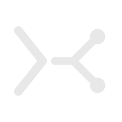
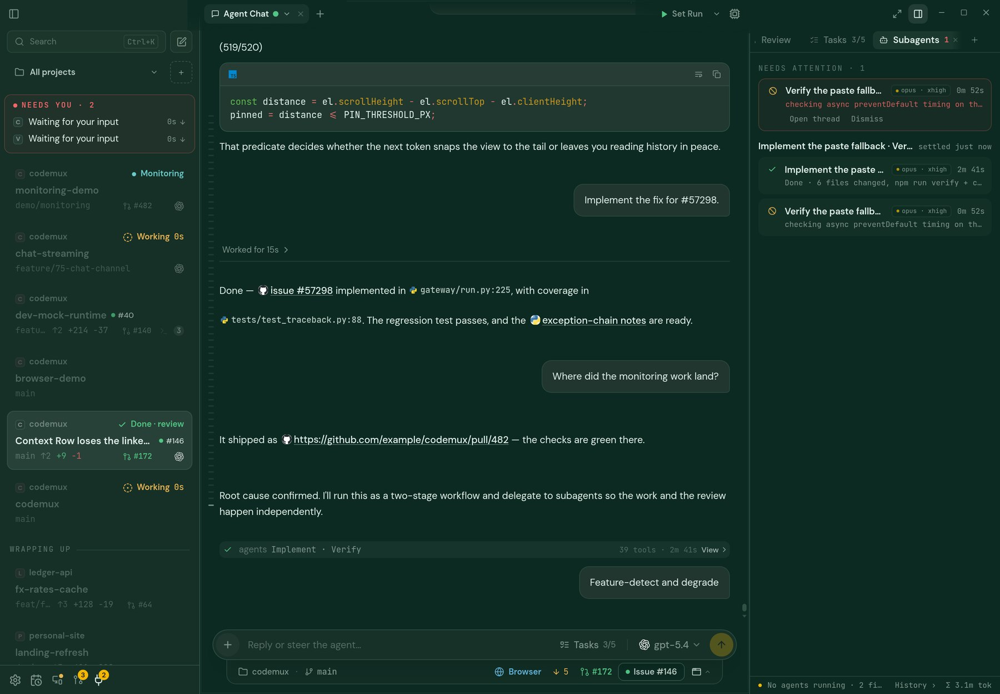

<div align="center">



# Codemux

**The Agentic Development Environment for Builders**



</div>

---

Codemux is a Linux-first workspace that brings terminals, browser panes, and multi-agent orchestration into one app. Run coding agents side by side, review changes, test in-browser, and ship — without leaving the window.

## Features

- **Multi-workspace terminals** — Split, resize, swap, and manage terminal sessions across isolated workspaces
- **Browser panes** — Embedded browser alongside your terminals for testing and agent-assisted browsing
- **Git worktree isolation** — Each workspace gets its own worktree so agents never interfere with each other
- **Built-in diff review** — See what changed, commit, and manage branches without switching tools
- **Workflow orchestration** — Run structured Claude workflows with approval, progress, summaries, and agent drill-in
- **Notifications & attention signals** — Know exactly when an agent needs you, with desktop notifications and per-pane indicators
- **CLI & socket control** — Automate everything via `codemux` CLI or the local Unix socket API
- **Custom keybinds** — Full keyboard-first workflow with a command palette and rebindable shortcuts

## Install

### AppImage (any Linux distro)

Download the latest `.AppImage` from [Releases](https://github.com/Zeus-Deus/codemux/releases), make it executable, and run:

```bash
chmod +x Codemux-*.AppImage
./Codemux-*.AppImage
```

### Upgrade note for OpenCode

When upgrading to a build with authenticated local notifications, restart OpenCode in any terminal that was running it before the upgrade. OpenCode loads the updated notification plugin on restart and resumes updating the pane’s status.

### Requirements

- Linux (X11 or Wayland)
- git
- [ydotool](https://github.com/ReimuNotMoe/ydotool) with ydotoold running — needed for browser automation
- A Chromium-based browser (Chromium, Google Chrome, or Brave) — for browser panes
- [ripgrep](https://github.com/BurntSushi/ripgrep) — file content search
- [fd](https://github.com/sharkdp/fd) — file name search
- [GitHub CLI](https://cli.github.com/) — PR creation and GitHub integration
- [xdg-utils](https://www.freedesktop.org/wiki/Software/xdg-utils/) — open in file manager

### Hyprland file dialogs

Codemux does not change your compositor's config. Omarchy already floats portal file dialogs. On plain Hyprland, add this to your own config if you want them floating too. This is the Lua config syntax of Hyprland 0.55 and later (shown for 0.57):

```lua
hl.window_rule({ match = { class = "^(xdg-desktop-portal-gtk)$" }, float = true, center = true, size = { 800, 600 } })
```

## Quick Start

1. Launch Codemux
2. Create a project by pointing it at a git repository
3. Create a workspace — each workspace gets an isolated git worktree
4. Open terminal panes, start your coding agent, and work

Split panes with keybinds, open a browser pane for testing, and use the changes panel to review diffs and commit when ready.

## Outside agents (MCP)

Codemux is an MCP server. With an authenticated network grant, Claude Code, Codex, a Hermes chat bot, or another MCP client can:

- open workspaces and create worktrees;
- start Codemux threads with a chosen provider, model and permission mode;
- send messages, wait for the result and read it;
- answer approvals and questions.

On this computer, with Codemux running:

```bash
claude mcp add --scope user codemux -- codemux mcp --client claude-code
```

From another device, run the same `codemux mcp` over SSH for read-only access, or turn on **Settings → Connections → Outside assistants → Over the network**, put HTTPS in front of it, and sign in with OAuth or a token. A standalone local or SSH `codemux` process can read the running app but cannot change workspaces, threads, connector settings, or Remote Access. Manage those settings in the desktop app before starting headless `codemux serve`; an authenticated network grant has its own access policy.

[docs/outside-agents.md](docs/outside-agents.md) covers per-client setup (including Hermes), the end-to-end flow, access levels and security. The [MCP Server docs](https://docs.codemux.org/mcp-server) list every tool.

## Build from Source

```bash
# Clone the repo
git clone https://github.com/Zeus-Deus/codemux.git
cd codemux

# Linux only: check build prerequisites
bash scripts/check-deps.sh

# Install dependencies
npm install

# Run in development mode
npm run tauri:dev

# Build for release
npm run tauri:build
```

Desktop builds require Rust, Node.js, and Bun 1.3.12 for the sidecars. For system dependencies on Windows and Linux, follow the [Tauri prerequisites for your platform](https://v2.tauri.app/start/prerequisites/).

## License

Elastic License 2.0 — see [LICENSE.md](LICENSE.md).
